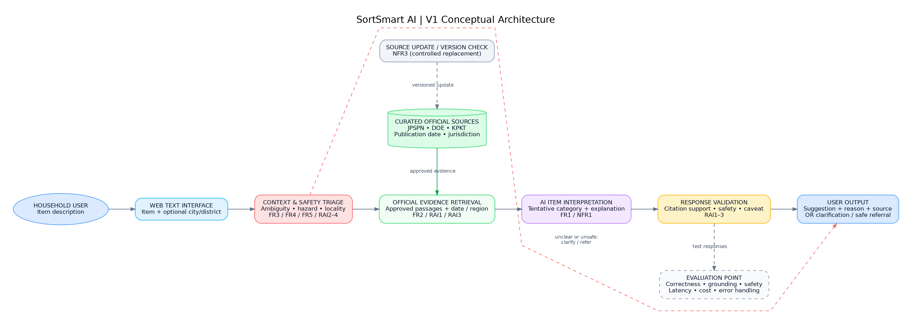

# Topic 2 Lab — Part C: V1 Architecture Decisions and Traceability

**Project:** SortSmart AI | **Version:** 1.0 | **Date:** 4 November 2026 
**Architecture maturity:** Conceptual V1 — specific model, retrieval index, frameworks and deployment choices are intentionally not fixed.

## Step C1 — Simplest viable flow

**User's text item description → SortSmart web interface → AI categorisation/answer capability → cited recommendation.**

This minimal flow can suggest a label but is not sufficient for the requirements. Without additional controls it may invent source claims (`FR2/RAI1`), mis-handle hazardous descriptions (`FR4/RAI2`), ignore local jurisdiction (`FR5/RAI3`) or apply dated general guidance as current policy. V1 therefore adds only components justified below.

## Step C2 — Requirements-to-architecture needs

| Requirement ID | What the requirement needs | Architecture response |
|---|---|---|
| **FR1 / NFR1** | Interpreting text item descriptions and proposing a supported tentative category. | Text-item interpretation/category suggestion capability informed by retrieved evidence. |
| **FR2 / RAI1** | Reliable links, identifiable publication dates and support for each factual claim. | Versioned official-source library, evidence retrieval, source-metadata store and output citation check. |
| **FR3** | Recognising insufficient item description instead of guessing. | Ambiguity/low-evidence detection and one targeted follow-up path. |
| **FR4 / RAI2** | Safe e-waste/hazard referrals and avoidance of risky invented instructions. | Hazard/scope triage before response creation plus response validation. |
| **FR5 / RAI3 / RAI4** | Optional broad locality, date/jurisdiction cautions and minimal personal data. | Locality/freshness context check with no precise-address requirement; minimal-data interaction. |
| **FR6** | Human-readable output with reason, official link and caveat. | Structured response presentation and formatting check. |
| **NFR2 / NFR5** | Responsive, affordable interaction. | Single-pass conceptual flow, limited retrieved material and recorded evaluation point. |
| **NFR3 / NFR4** | Safe document updates and graceful request handling. | Swappable source library, controlled ingestion/update path and fallback error handling. |
| **FR7 / RAI4** | Reject invalid/out-of-scope input and prevent volunteered identifiers from reaching external services. | Input triage performs validation, PII blocking/redaction and scope checks before retrieval or generation. |

## Step C3 — V1 Conceptual Architecture Diagram

**Main flow:** Household user → browser text form → input / ambiguity / hazard / general-locality triage → authoritative evidence retrieval + source-date/jurisdiction context → AI-supported tentative category and explanation → citation / safety validation → source-linked response, clarification or safe referral.

**Supporting flow:** Curated official documents and metadata feed retrieval; test cases and anonymised measurements feed the evaluation point. **No technology vendor or model is prescribed at this stage.**

**Why this is not a copied EduAdvisor architecture:** SortSmart requires waste-category interpretation, hazardous-item safeguards, municipality-specific caution and dated-policy checks. Its extra controls are derived directly from its own FR/RAI requirements.

## Step C4 — Architecture Decision Record (ADR)

| Decision | Requirement / constraint | Alternatives considered | Selected option | Trade-off accepted |
|---|---|---|---|---|
| **ADR1: Retrieve curated evidence with source metadata** | FR2, RAI1, RAI3; no invented local rules | LLM memory only; direct hard-coded FAQs; retrieval from a versioned approved-source set | Versioned source library + retrieval of relevant official passages with date/jurisdiction fields | Higher ingestion/update effort and possible added latency, in return for auditable citations and source-currency checks. |
| **ADR2: Add explicit hazard and ambiguity triage** | FR3, FR4, RAI2 | Answer directly; rely only on prompt wording; dedicated pre-answer triage | Detect ambiguity and risky/e-waste intent before answer composition; allow clarification/referral | May cause occasional over-cautious refusals and extra branching, but reduces risky guesses. |
| **ADR3: Use optional broad location, not precise geolocation** | FR5, RAI3, RAI4 | Always require home address; ignore locality; optional city/district | Optional broad locality, visible jurisdiction/source-date caution, local verification prompt | Some advice remains generic; safer privacy and fewer unsupported local guarantees. |
| **ADR4: Keep one modular response pipeline for V1** | NFR2, NFR3, NFR5; one-semester scope | Multi-agent orchestration; complex live-service integration; modular single flow | Single conceptual pipeline with separable sources, triage, retrieval, AI response and validation | Less sophistication and automation initially, but lower cost, complexity and easier future replacement. |

### Initial Requirements Traceability Matrix

| Objective | Requirement(s) | Evaluation criterion | Architecture element | Later evidence to collect |
|---|---|---|---|---|
| **O1** | FR2, RAI1 | Citation presence and source support | Official-source library + metadata + evidence retrieval | 30-answer citation audit and reviewed source coverage notes. |
| **O1** | FR5, RAI3 | Correct locality/freshness warning | Locality/source-date gate | 15 locality-sensitive/stale-source test cases. |
| **O2** | FR1, NFR1 | Category suggestion correctness | Text interpretation + category suggestion capability | ≥40 human-adjudicated item cases and confusion matrix. |
| **O2** | FR3 | Appropriate ambiguity clarification | Ambiguity triage | 20 ambiguous item examples and response rubric. |
| **O2** | FR4, RAI2 | Safe e-waste/hazard referral | Hazard/scope gate + safety validation | ≥20 hazard cases and refusal/referral outcomes. |
| **O2** | FR6 | Clear output | Structured response presentation | 15 double-rated responses using clarity rubric. |
| **O3** | NFR2, NFR5 | Response latency / inference cost | Instrumented evaluation point | 50-request latency sample, 100-request cost report. |
| **O3** | NFR3, NFR4 | Source update time / graceful request handling | Source ingestion/update path + fallback handling | Controlled document-update stopwatch; 100-request reliability trial. |
| **O2** | FR7 | Scope/input validation | Context and safety triage | 20 out-of-scope and 5 invalid cases. |
| **O3** | RAI4 | Zero PII events | Input redaction/blocking and minimal logging | 20 seeded cases with payload and log inspection. |

### Final V1 review checklist

- [x] Each added component is linked to an FR, NFR or RAI requirement.
- [x] Relevant official-source documents and date/jurisdiction context are represented.
- [x] Ambiguity, hazardous-item, unsafe advice and privacy controls are visible.
- [x] The output has a citation check and optional clarification/referral path.
- [x] Test/evaluation point is indicated; **test results are not claimed**.
- [x] No specific LLM, vector database, UI framework or deployment platform is prescribed prematurely.
- [x] One modular pipeline is simpler than an unjustified multi-agent architecture.

**Reflection — most important architecture trade-off:** 
`ADR1` has the greatest impact. A bare language model would be faster to prototype, but could produce plausible yet unsupported sorting instructions. Adding official-source retrieval and date/jurisdiction metadata creates maintenance and latency costs; I accept those costs to make guidance easier to verify and to reduce the risk of outdated or fabricated claims. The component does **not** guarantee perfect factual correctness, so `RAI1` and `RAI3` still require evaluation.

### Future Week 3 preparation (not yet completed)

- Obtain 2–3 permitted PDF source documents relevant to the domain; record their source URLs, versions and dates.
- Read one PDF and note likely parsing challenges (tables, headers, footnotes).
- Prepare the Google Colab environment for document parsing and retrieval experiments.
- Keep PDF redistribution and licensing restrictions in mind.

### Control and data-flow details

The diagram is conceptual, with a normal evidence-to-answer route and a dashed early clarification/referral route. The early route uses pre-reviewed templates and approved official links only; it must not generate uncited disposal procedures. Empty, unrelated or PII-bearing input is validated, declined or redacted within context/safety triage before external calls. If redaction is uncertain, request a rewritten description without identifiers.

Retrieval returns approved passages and immutable source IDs plus publication/retrieval dates and jurisdiction. A missing or conflicting passage leads to uncertainty/abstention. Output validation checks that cited IDs exist and that claims match applicable evidence; failed validation produces a safe fallback rather than releasing the draft. Automatic support checking is fallible and must be assessed through the human citation audit. Source ingestion excludes contaminated/unrelated text, treats document instructions as untrusted data, and requires manual approval before replacement. Undated pages are labelled honestly.

The evaluation point is a cross-cutting test harness: it observes rendered output (including early refusals), submission/completion timestamps, model usage and error status. It is not another model in the response path. Synthetic benchmark prompts/responses may be saved for reviewers; normal-user raw prompts/responses, precise location and identifiers are not persisted. Aggregate counters are sufficient for V1 operational checks. This supports NFR2/NFR4/NFR5 and RAI4 without adding a production analytics platform.

**ADR status:** ADR1–ADR4 are selected planning decisions, not implemented capabilities. The editable [Draw.io source](week2_architecture_v1.drawio) and [Graphviz source](week2_architecture_v1.dot) accompany the PNG; their layouts differ but represent the same conceptual components and flows.
